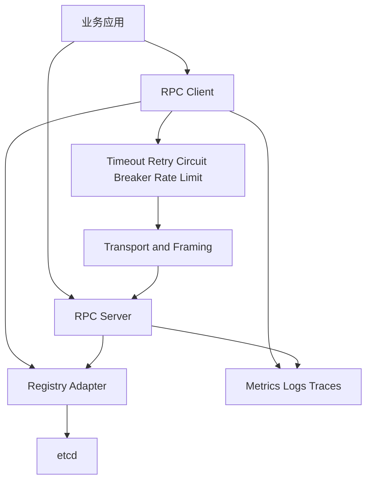

# Mini-RPC 技术设计与分阶段执行文档

**项目名称**：Mini-RPC

**项目定位**：面向 Go 微服务场景的可治理 RPC 框架，提供接口定义、代码生成、网络传输、服务发现、负载均衡、超时重试、熔断限流、可观测性和故障恢复能力。

**文档版本**：v1.0

**文档日期**：2026-11-13

**目标读者**：项目实现者、负责分批执行的智能体、代码审查者、面试准备者。

---

## 1. 项目目标

Mini-RPC 的目标是实现一个可以运行在本地多进程环境中的 RPC 框架，并通过测试、压测和故障注入证明主要机制有效。

项目最终需要能够完成以下流程：

```text
.proto 接口定义
      ↓
代码生成客户端和服务端桩代码
      ↓
服务端注册到注册中心
      ↓
客户端发现服务实例
      ↓
负载均衡选择实例
      ↓
建立或复用连接
      ↓
编码、发送、解码 RPC 请求
      ↓
执行超时、重试、熔断和限流策略
      ↓
输出日志、指标和 Trace
```

项目强调三个结果：

1. 有明确的协议和模块边界。
2. 有可重复运行的单元测试、集成测试、并发测试和基准测试。
3. 有可解释的设计取舍，能够说明与 gRPC、Kitex、Dubbo-go、Kratos 等项目的关系。

## 2. 项目边界

### 2.1 第一版本必须完成

- Go 语言实现。
- Protobuf 接口定义。
- 基于 TCP 的自定义二进制帧协议。
- 一元 RPC 调用。
- 客户端和服务端连接管理。
- 服务注册、服务发现和健康状态。
- Round Robin 和加权 Round Robin。
- 请求超时、有限次重试和指数退避。
- 基于错误率的熔断器。
- 基于令牌桶的客户端限流。
- 请求 ID 和 Trace ID 透传。
- Prometheus 风格指标。
- 优雅关闭。
- Docker Compose 示例。
- 故障注入和基准测试。

### 2.2 第一版本暂不实现

- 完整 HTTP/2 协议栈。
- 多语言代码生成。
- 跨机房流量调度。
- 分布式事务。
- 完整的流式 RPC。
- 生产级安全认证体系。
- 自己实现 Raft 集群。

注册中心第一版本采用外部 etcd 单节点或三节点测试集群。这样可以把重点放在 RPC 框架自身，同时保留对 Watch、Lease 和服务失效恢复的工程实践。

## 3. 技术选型

| 领域 | 第一版本选择 | 选择理由 |
|---|---|---|
| 语言 | Go 1.23 或更高版本 | 适合网络服务、并发控制和中间件开发 |
| 接口定义 | Protobuf | 有成熟的 IDL、代码生成和类型系统 |
| 传输 | TCP 长连接 | 可以直接展示分帧、连接复用和并发控制 |
| 序列化 | Protobuf | 与接口定义统一，减少重复协议设计 |
| 注册中心 | etcd v3 | 提供 gRPC、Watch、Lease 和一致性语义 |
| 指标 | Prometheus exposition format | 易于本地抓取与展示 |
| 链路 | OpenTelemetry API | 便于后续接入标准化观测体系 |
| 测试 | Go testing、race detector、testcontainers 或 Docker Compose | 覆盖并发、集成和容器环境 |
| 压测 | Go benchmark、ghz 或自定义压测客户端 | 统计吞吐量、P50、P95、P99 |
| CI | GitHub Actions | 自动执行格式检查、单元测试、竞态测试和构建 |

## 4. GitHub 参考项目

参考项目用于学习接口边界、目录组织、测试方式和工程文档。实现 Mini-RPC 时应独立编写代码，并在项目文档中注明参考关系。

### 4.1 RPC 框架

- [grpc/grpc-go](https://github.com/grpc/grpc-go)

  Go 实现的 gRPC，适合参考服务端、客户端、连接状态、拦截器、负载均衡、代码生成和测试组织。官方仓库定位为基于 HTTP/2 的高性能通用 RPC 框架，并提供快速开始、底层技术文档、示例和 benchmark。genui{"citation":{"ref":"turn36search0"}}

- [cloudwego/kitex](https://github.com/cloudwego/kitex)

  适合参考可扩展传输层、协议抽象、代码生成、连接池、超时、重试、熔断、限流、监控和链路追踪。Kitex 同时展示了如何把服务治理功能组织成可插拔模块。genui{"citation":{"ref":"turn0search8"}}

- [apache/dubbo-go](https://github.com/apache/dubbo-go)

  适合参考服务发现、负载均衡、流量管理、限流、重试、配置和多协议支持。Mini-RPC 第一版本只实现其中的核心子集。genui{"citation":{"ref":"turn6search0"}}

- [go-kratos/kratos](https://github.com/go-kratos/kratos)

  适合参考轻量模块边界、HTTP 和 gRPC 传输抽象、中间件组合、注册中心接口、配置接口和代码生成流程。genui{"citation":{"ref":"turn34search0"}}

### 4.2 注册中心与一致性

- [etcd-io/etcd](https://github.com/etcd-io/etcd)

  etcd 使用 Raft 管理高可用复制日志，并通过 gRPC 提供 KV、Watch 和 Lease 能力。Mini-RPC 使用它作为外部注册中心。genui{"citation":{"refs":["turn4search0","turn4search3"]}}

- [alibaba/nacos](https://github.com/alibaba/nacos)

  适合参考服务发现、健康检查、动态配置和监听机制。genui{"citation":{"ref":"turn9search4"}}

- [hashicorp/consul](https://github.com/hashicorp/consul)

  适合参考服务目录、健康检查、服务发现接口和服务治理边界。genui{"citation":{"ref":"turn38search1"}}

### 4.3 网络代理与中间件扩展

- [apache/apisix](https://github.com/apache/apisix)

  适合参考路由匹配、上游选择、动态配置、插件运行时、限流、熔断和可观测性组织方式。genui{"citation":{"refs":["turn16search0","turn16search2"]}}

- [envoyproxy/envoy](https://github.com/envoyproxy/envoy)

  适合参考连接池、线程模型、服务代理、TLS、路由、统计和扩展机制。Envoy 是云原生边缘代理和服务代理，完整项目规模远大于本项目，只作为设计参考。genui{"citation":{"ref":"turn20search2"}}

### 4.4 消息与观测系统

- [nats-io/nats-server](https://github.com/nats-io/nats-server)

  JetStream 展示了 Stream、Consumer、ACK、消息重放、持久化和重复投递机制，适合后续扩展异步 RPC。genui{"citation":{"ref":"turn25search4"}}

- [open-telemetry/opentelemetry-collector](https://github.com/open-telemetry/opentelemetry-collector)

  适合参考 Receiver、Processor、Exporter 和 Pipeline 的可插拔设计。Mini-RPC 可以借鉴其组件接口和生命周期管理。genui{"citation":{"refs":["turn24search0","turn24search1","turn24search2"]}}

- [hashicorp/memberlist](https://github.com/hashicorp/memberlist)

  适合参考 Gossip、SWIM、成员状态和故障检测。如果以后实现自有注册中心，可以将其作为成员管理参考。genui{"citation":{"refs":["turn27search0","turn27search1"]}}

## 5. 总体架构



### 5.1 客户端调用链

```text
业务调用
  → 生成 request_id 和 trace_id
  → 选择服务实例
  → 检查熔断状态
  → 获取限流令牌
  → 获取或建立连接
  → 编码帧
  → 写入连接
  → 等待响应或超时
  → 根据错误类型决定重试
  → 更新指标和熔断状态
  → 返回响应
```

### 5.2 服务端调用链

```text
接受 TCP 连接
  → 读取固定头部
  → 校验版本、长度和请求类型
  → 读取完整请求体
  → 解析服务名和方法名
  → 查找服务实现
  → 创建请求上下文
  → 执行业务方法
  → 编码响应或错误
  → 写回响应
  → 记录指标和 Trace
```

### 5.3 目录结构

```text
mini-rpc/
├── api/
│   ├── echo/v1/echo.proto
│   └── generated/
├── cmd/
│   ├── echo-server/
│   └── echo-client/
├── internal/
│   ├── codec/
│   ├── protocol/
│   ├── transport/
│   ├── client/
│   ├── server/
│   ├── registry/
│   ├── resolver/
│   ├── balancer/
│   ├── governance/
│   ├── observability/
│   └── testkit/
├── pkg/
│   └── rpc/
├── examples/
├── benchmark/
├── fault-injection/
├── deploy/
│   └── docker-compose.yaml
├── docs/
├── go.mod
├── Makefile
├── README.md
├── CONTRIBUTING.md
├── CHANGELOG.md
└── LICENSE
```

`pkg/rpc` 只暴露稳定的用户接口。`internal` 保存协议、连接管理和治理策略实现。测试工具放在 `internal/testkit`，避免测试代码分散在业务示例中。

## 6. 协议设计 v1

### 6.1 设计目标

- 能够在 TCP 字节流上正确分帧。
- 能够检测长度错误、版本错误和非法类型。
- 支持请求和响应关联。
- 支持 Metadata、超时和 Trace ID。
- 允许以后加入压缩、流式调用和认证字段。

### 6.2 帧格式

所有整数使用大端序。帧由固定头部和可变部分组成。

| 字段 | 长度 | 说明 |
|---|---:|---|
| Magic | 2 bytes | 固定为 `0x4D52`，表示 Mini-RPC |
| Version | 1 byte | 当前为 `1` |
| Type | 1 byte | Request、Response、Cancel、Heartbeat |
| Flags | 2 bytes | 压缩、错误、单向请求等标志 |
| HeaderLength | 4 bytes | Metadata 区域长度 |
| BodyLength | 4 bytes | Protobuf body 长度 |
| RequestID | 8 bytes | 单连接内唯一的请求编号 |
| Header | variable | 键值 Metadata |
| Body | variable | Protobuf 请求或响应 |

第一版本限制：

- Header 最大 64 KiB。
- Body 最大 8 MiB，可通过配置调整。
- 单连接最大并发请求数默认为 1024。
- 无法识别的 Magic、Version 或 Type 立即关闭连接。
- BodyLength 超过上限时返回协议错误并关闭连接。

### 6.3 Metadata

Metadata 使用长度前缀的键值对编码。第一版本保留以下键：

- `service`
- `method`
- `deadline_unix_nano`
- `trace_id`
- `span_id`
- `content_type`
- `retry_attempt`

服务名和方法名也应由生成代码提供，Metadata 中的值用于服务端路由和调试。

### 6.4 错误码

| 错误码 | 含义 | 是否允许重试 |
|---|---|---|
| OK | 调用成功 | 否 |
| INVALID_ARGUMENT | 参数非法 | 否 |
| NOT_FOUND | 服务或方法不存在 | 否 |
| DEADLINE_EXCEEDED | 超时 | 视请求幂等性决定 |
| UNAVAILABLE | 服务暂时不可用 | 是 |
| RESOURCE_EXHAUSTED | 限流或资源不足 | 视 Retry-After 决定 |
| INTERNAL | 服务内部错误 | 默认否 |
| CANCELED | 请求被取消 | 否 |
| PROTOCOL_ERROR | 协议错误 | 否 |

## 7. 对外 API 设计

第一版本 API 需要保持简单，避免在早期暴露内部类型。

```go
type ClientConn interface {
    Invoke(ctx context.Context, service string, method string, in proto.Message, out proto.Message) error
    Close() error
}

type Server interface {
    Register(service ServiceDesc, implementation any) error
    Serve(listener net.Listener) error
    GracefulStop(ctx context.Context) error
}

type Resolver interface {
    Resolve(ctx context.Context, service string) ([]Instance, error)
    Watch(ctx context.Context, service string) (<-chan Update, error)
}

type Balancer interface {
    Pick(ctx context.Context, instances []Instance) (Instance, error)
}
```

生成代码需要提供：

- `RegisterEchoServer` 风格的注册函数。
- 客户端调用接口。
- 方法描述和请求响应类型信息。
- 服务端方法分发入口。

生成代码的具体命名应遵循 Protobuf 生成工具习惯，避免创造与现有生态冲突的命名。

## 8. 核心模块设计

### 8.1 Protocol

职责：

- 定义 Header、Request、Response、ErrorCode。
- 进行帧编码和解码。
- 校验 Magic、Version、长度和类型。
- 统一处理 `io.Reader` 的部分读取。
- 提供协议错误类型。

测试重点：

- 粘包。
- 拆包。
- 空 body。
- 超大 header。
- 截断帧。
- 非法版本。
- 并发编码不能共享可变缓冲区。

### 8.2 Transport

职责：

- TCP 监听和拨号。
- 长连接复用。
- 连接状态管理。
- 写队列或写锁。
- RequestID 到响应 channel 的映射。
- 连接关闭时唤醒所有等待请求。
- 心跳和空闲连接清理。

连接关闭时，所有未完成请求必须返回明确错误，不能永久阻塞。

### 8.3 Server

职责：

- 接受连接。
- 解析请求。
- 根据服务名和方法名查找实现。
- 设置 deadline。
- 捕获业务 panic 并返回 INTERNAL。
- 支持优雅关闭。
- 输出服务级和方法级指标。

### 8.4 Client

职责：

- 创建连接池。
- 选择连接。
- 分配 RequestID。
- 写入请求并等待响应。
- 处理上下文取消。
- 连接异常时重新拨号。
- 防止同一个请求被重复写入。

### 8.5 Registry

定义统一接口，第一版本实现 etcd：

```go
type Registry interface {
    Register(ctx context.Context, instance Instance, ttl time.Duration) (Lease, error)
    Deregister(ctx context.Context, instance Instance) error
    List(ctx context.Context, service string) ([]Instance, error)
    Watch(ctx context.Context, service string) (<-chan RegistryEvent, error)
}
```

服务实例至少包含：

```go
type Instance struct {
    ID       string
    Service  string
    Address  string
    Weight   int
    Metadata map[string]string
}
```

服务端注册必须绑定 Lease，并通过 KeepAlive 续期。进程异常退出后，实例应在 TTL 到期后从客户端可见列表中消失。

### 8.6 Resolver 与 Balancer

Resolver 负责维护本地实例快照，不能在每次 RPC 调用时都同步访问注册中心。Watch 断开后需要执行重连和全量刷新。

Balancer 第一版本实现：

- Round Robin。
- Weighted Round Robin。

所有 Balancer 都需要在空实例、实例刚刚下线和 Watch 更新并发到达时保持可预测行为。

### 8.7 Governance

#### 超时

- 调用必须遵循 `context.Context` 的 deadline。
- 没有 deadline 时使用客户端默认超时。
- 连接建立、写入、等待响应分别计时。
- 超时后必须从 pending map 删除请求。

#### 重试

默认只对以下错误重试：

- `UNAVAILABLE`。
- 连接建立失败。
- 连接在收到响应前关闭。

默认不重试业务错误、参数错误和非幂等请求。重试配置至少包含最大次数、最大总耗时、初始退避和最大退避。

#### 熔断

状态：

```text
Closed → Open → HalfOpen → Closed
                 ↓
                Open
```

第一版本可以采用固定窗口统计：在窗口内累计请求数和失败数，失败率超过阈值后进入 Open。Open 状态经过冷却时间后允许有限数量探测请求。

#### 限流

第一版本使用本地令牌桶。限流器需要支持：

- 每秒令牌生成速率。
- 桶容量。
- 等待或立即拒绝。
- 指标统计。
- 服务级和方法级配置。

### 8.8 Observability

至少记录以下指标：

- `rpc_requests_total`。
- `rpc_requests_failed_total`。
- `rpc_request_duration_seconds`。
- `rpc_inflight_requests`。
- `rpc_connections`。
- `rpc_retries_total`。
- `rpc_circuit_state`。
- `rpc_rate_limited_total`。
- `rpc_registry_instances`。

日志需要包含 service、method、request_id、trace_id、instance、duration、attempt 和 error_code。

第一版本可以通过 OpenTelemetry API 创建 Span，Exporter 使用控制台或 OTLP 示例实现。

## 9. 测试策略

### 9.1 单元测试

覆盖协议编码、解码、请求状态、连接池、负载均衡、重试判断、熔断状态机、令牌桶和实例快照更新。

要求：

- 正常路径和错误路径都覆盖。
- 测试名称表达行为，例如 `TestDecoderHandlesSplitFrame`。
- 测试不能依赖公网和固定机器地址。
- 每个失败都能输出足够上下文。

### 9.2 集成测试

使用本地进程或 Docker Compose 启动：

- 一个 etcd。
- 两个 RPC Server。
- 一个 RPC Client。
- 一个 Prometheus 或指标抓取容器，可作为可选组件。

测试服务注册、发现、调用、实例下线、Watch 重连和客户端恢复。

### 9.3 并发测试

- 多 goroutine 并发调用同一连接。
- 多 goroutine 并发建立和关闭连接。
- Watch 更新与请求选择并发发生。
- 服务端优雅关闭期间继续有请求进入。
- 连接异常时大量请求同时返回。

执行：

```bash
go test -race ./...
```

### 9.4 故障注入

至少支持以下故障：

- 服务实例停止。
- TCP 连接被强制关闭。
- 响应延迟。
- 响应丢失。
- 注册中心短暂不可用。
- 客户端超过限流阈值。
- 服务端持续返回错误。

故障注入不能依赖修改业务代码。建议通过测试 Server、代理层或配置项实现。

### 9.5 性能测试

至少比较：

- 单连接串行调用。
- 单连接并发调用。
- 多连接并发调用。
- 不启用治理策略和启用治理策略。
- 不同消息体大小。
- 不同负载均衡策略。

记录：

- QPS。
- P50、P95、P99 延迟。
- 错误率。
- CPU。
- 内存。
- 活跃连接数。
- 重试次数。

性能结果必须记录测试机器、Go 版本、消息大小、并发数和提交版本。

## 10. 分阶段执行清单

下面的清单可以直接交给智能体逐项执行。每一项都要求完成代码、测试、文档更新和独立提交。后续智能体开始某一阶段前，应先阅读本阶段的依赖阶段提交和 `docs/` 中已有设计。

### 阶段 0：建立仓库和工程规范

**建议提交**：`chore: initialize mini-rpc repository`

**执行内容**：

- 初始化 Go module。
- 创建目录结构。
- 添加 Makefile。
- 添加 `.golangci.yml`、`.gitignore` 和 LICENSE。
- 添加 GitHub Actions。
- 添加 README，说明项目目标、运行方式和阶段计划。
- 添加 `docs/architecture.md`，记录本设计文档的核心内容。

**测试标准**：

```bash
go test ./...
go vet ./...
go fmt ./...
go build ./...
```

**验收条件**：

- 空项目可以通过 CI。
- 目录结构与文档一致。
- README 可以指导新开发者运行最小示例。

### 阶段 1：定义 Protobuf API 与生成流程

**建议提交**：`feat: add echo service definition and code generation`

**执行内容**：

- 添加 `api/echo/v1/echo.proto`。
- 定义 Echo 请求、响应和服务。
- 配置 `protoc` 和 Go 代码生成。
- 添加生成脚本或 Makefile 目标。
- 生成客户端接口、服务端接口和方法描述。
- 添加一个只依赖生成代码的接口测试。

**测试标准**：

```bash
make proto
make proto-check
```

`proto-check` 应验证生成文件在重复生成后没有未提交变化。

**验收条件**：

- 删除生成文件后可以由命令重新生成。
- 业务代码不直接手写服务方法分发表。
- 生成的客户端和服务端接口可以被示例程序引用。

### 阶段 2：实现协议帧编码和解码

**建议提交**：`feat: implement binary rpc frame codec`

**执行内容**：

- 实现固定头部和可变 body。
- 实现大端序读写。
- 实现 Header、Body 长度校验。
- 实现请求、响应、取消和心跳类型。
- 定义协议错误。
- 限制最大 header 和 body。

**测试标准**：

- 编码后解码得到等价结构。
- 一次读取半个头部可以继续读取。
- 一次读取多个帧可以依次解析。
- 截断帧返回错误。
- 非法 Magic、Version、Type 和长度返回错误。
- `go test -race ./internal/protocol/...` 通过。

**验收条件**：

- 协议测试不使用真实网络。
- 每种协议错误都有独立测试。
- `docs/protocol.md` 包含字段表和示例十六进制帧。

### 阶段 3：实现 TCP Transport 和单机调用

**建议提交**：`feat: add tcp transport and unary invocation`

**执行内容**：

- 实现 TCP Listener 和 Dialer。
- 实现 Server 接受连接和请求循环。
- 实现 Client 发送请求和等待响应。
- 实现 RequestID 与 pending map。
- 实现连接关闭时唤醒 pending 请求。
- 实现 Echo Server 和 Echo Client。

**测试标准**：

- 单机请求成功。
- 并发请求全部返回。
- 服务端主动关闭连接后客户端返回错误。
- 客户端取消请求后不出现 goroutine 泄漏。
- 服务端返回业务错误时客户端可以识别错误码。
- 运行 `go test -race ./...` 无数据竞争。

**验收条件**：

```bash
go run ./cmd/echo-server
go run ./cmd/echo-client
```

能够完成一次真实 TCP RPC 调用。

### 阶段 4：连接池、连接复用和优雅关闭

**建议提交**：`feat: add connection pooling and graceful shutdown`

**执行内容**：

- 实现每个实例的连接池。
- 实现连接上限和空闲连接回收。
- 支持单连接多请求并发。
- 处理拨号失败和连接重新建立。
- 实现 Server GracefulStop。
- 服务端停止接收新请求后等待已开始请求完成。

**测试标准**：

- 1000 个请求不会创建 1000 个 TCP 连接。
- 连接池达到上限时行为可预测。
- 连接异常后后续请求可以恢复。
- GracefulStop 不丢失已接受且未超时的请求。
- 停止流程有超时，不能永久阻塞。

**验收条件**：

- 连接数、活跃请求数和关闭原因有测试指标。
- 没有明显 goroutine 泄漏。
- 连接池策略写入 `docs/connection-pool.md`。

### 阶段 5：服务注册与发现

**建议提交**：`feat: add etcd registry and resolver`

**执行内容**：

- 实现 Registry 接口。
- 使用 etcd Lease 注册服务实例。
- 实现 KeepAlive。
- 实现 List 和 Watch。
- 客户端维护本地实例快照。
- Watch 断开后执行重连和全量刷新。
- 实现实例下线。

**测试标准**：

- 服务实例注册后可被客户端发现。
- Lease 到期后实例从列表消失。
- 两个实例都注册时客户端收到两个实例。
- 一个实例停止后客户端最终移除该实例。
- Watch 中断后恢复连接可以继续得到更新。
- 注册中心暂时不可用时已有实例快照仍可按策略使用。

**验收条件**：

- Docker Compose 可以启动 etcd 和两个 Echo Server。
- 集成测试不依赖外部 etcd。
- `docs/registry.md` 记录 TTL、Watch 和断线恢复语义。

### 阶段 6：负载均衡

**建议提交**：`feat: add round robin and weighted load balancing`

**执行内容**：

- 定义 Balancer 接口。
- 实现 Round Robin。
- 实现 Weighted Round Robin。
- 处理实例添加、删除和权重修改。
- 处理空实例列表。
- 处理并发 Pick。

**测试标准**：

- Round Robin 的顺序符合预期。
- 多轮请求的实例分布符合权重比例。
- 实例下线后不会继续选择。
- 空列表返回明确错误。
- 并发 Pick 不发生数据竞争。

**验收条件**：

- 至少有 10 万次选择的统计测试。
- 负载均衡分布结果写入 benchmark。
- README 展示两种策略的配置方式。

### 阶段 7：超时和请求取消

**建议提交**：`feat: add deadline propagation and cancellation`

**执行内容**：

- 支持 context deadline。
- 将 deadline 写入 Metadata。
- 服务端创建带 deadline 的上下文。
- 客户端超时后清理 pending map。
- 支持取消帧或连接内取消标记。
- 区分连接建立、写入和响应等待超时。

**测试标准**：

- 服务端延迟超过 deadline 时客户端返回 DEADLINE_EXCEEDED。
- 客户端超时后不会收到重复响应错误。
- 取消请求后服务端可以观察到取消状态。
- 大量超时请求后 pending map 最终为空。
- 超时场景不存在 goroutine 泄漏。

**验收条件**：

- `docs/timeout.md` 明确每一层超时的职责。
- 测试可以证明超时请求不会无限占用资源。

### 阶段 8：重试和熔断

**建议提交**：`feat: add retry policy and circuit breaker`

**执行内容**：

- 定义可重试错误集合。
- 实现最大次数和总耗时限制。
- 实现指数退避和随机抖动。
- 支持幂等请求标记。
- 实现 Closed、Open、HalfOpen 状态机。
- 添加熔断状态指标。

**测试标准**：

- UNAVAILABLE 按配置重试。
- INVALID_ARGUMENT 不重试。
- 超过总 deadline 后停止重试。
- 熔断打开后快速拒绝请求。
- 冷却后允许探测请求。
- 探测成功恢复 Closed，探测失败回到 Open。
- 并发状态切换没有数据竞争。

**验收条件**：

- 测试输出每次请求的 attempt 数量。
- `docs/retry-and-circuit-breaker.md` 说明重试风暴和幂等性处理。
- 能通过故障注入演示服务不可用时的降级过程。

### 阶段 9：限流和资源保护

**建议提交**：`feat: add token bucket rate limiter`

**执行内容**：

- 实现本地令牌桶。
- 支持服务级和方法级限流。
- 支持立即拒绝和等待获取。
- 返回 RESOURCE_EXHAUSTED。
- 暴露限流计数和剩余令牌指标。
- 对连接数、并发请求数和 body 大小增加保护。

**测试标准**：

- 长期平均速率符合配置。
- 桶容量允许短时突发。
- 超限请求得到稳定错误码。
- 并发获取令牌不发生超发。
- 限流等待期间 context 取消可以立即返回。

**验收条件**：

- 有独立的限流 benchmark。
- 至少有一种客户端限流和一种服务端资源保护策略。
- 文档说明限流发生在调用链的位置。

### 阶段 10：可观测性

**建议提交**：`feat: add metrics logging and tracing`

**执行内容**：

- 加入结构化日志。
- 生成 request_id、trace_id 和 span_id。
- 实现客户端和服务端 Span。
- 暴露请求计数、错误数、耗时直方图、重试数、连接数和熔断状态。
- 提供调试日志开关。
- 添加本地指标抓取示例。

**测试标准**：

- 每次请求都有 request_id。
- 客户端和服务端日志能够通过 trace_id 关联。
- 成功、失败、超时和限流分别计数。
- 指标标签不会包含无限增长的 request_id。
- 关闭观测功能时 RPC 正常运行。

**验收条件**：

- `docs/observability.md` 说明指标名称和标签。
- 示例可以输出一条完整的客户端到服务端调用链。
- 指标结果可以被 Prometheus 格式抓取。

### 阶段 11：故障注入和恢复验证

**建议提交**：`test: add failure injection and recovery scenarios`

**执行内容**：

- 添加延迟注入。
- 添加响应错误注入。
- 添加连接强制关闭。
- 添加实例停止和恢复。
- 添加注册中心短暂不可用。
- 添加服务端资源耗尽场景。
- 记录恢复时间和错误率变化。

**测试标准**：

- 单实例故障时请求可以切换到其他实例。
- 所有实例故障时客户端返回可识别错误。
- 实例恢复后能够重新注册并接收请求。
- 注册中心短暂不可用后 Watch 能恢复。
- 熔断、重试和限流不会互相造成无限循环。

**验收条件**：

- 故障场景可以通过一个命令启动。
- 每个故障场景有预期结果和实际结果记录。
- `docs/failure-injection.md` 包含恢复时间定义。

### 阶段 12：性能基准和最终工程化

**建议提交**：`perf: add benchmarks and release documentation`

**执行内容**：

- 编写串行、并发、连接复用和多实例 benchmark。
- 比较启用和关闭治理功能的差异。
- 记录不同 body 大小下的 P50、P95 和 P99。
- 添加 Docker Compose 一键运行。
- 完善 README、CHANGELOG、CONTRIBUTING 和架构文档。
- 固定一个 v0.1.0 版本。

**测试标准**：

```bash
make test
make race
make benchmark
make docker-test
```

最终 benchmark 报告至少包含：

- 测试机器和 Go 版本。
- 编译参数。
- 消息体大小。
- 并发数。
- 连接数。
- QPS。
- P50、P95、P99。
- CPU 和内存。
- 错误率。
- 提交 SHA。

**验收条件**：

- 新环境可以按照 README 在 30 分钟内启动。
- CI 能自动执行格式检查、测试、竞态测试和构建。
- 发布包包含示例、协议说明、配置说明和 benchmark 报告。

## 11. 智能体执行规则

每次智能体执行一个阶段时，必须遵循以下流程：

1. 阅读本阶段目标、依赖阶段和验收条件。
2. 检查当前分支和最近提交，确认前置阶段已经完成。
3. 先阅读相关参考项目的 README、接口定义、测试和目录结构。
4. 只修改本阶段所需文件。
5. 先编写失败测试，再实现功能，除非是工程初始化阶段。
6. 执行本阶段测试标准。
7. 更新对应技术文档和 README。
8. 检查 `git diff`，删除调试代码和无用依赖。
9. 创建一个语义清晰的阶段性提交。
10. 在提交说明或阶段报告中记录实现内容、测试命令、测试结果和已知限制。

阶段报告模板：

```text
阶段：阶段 X
提交：<commit-sha>
实现：
- ...

测试：
- 命令：...
- 结果：通过 / 失败

验收：
- [x] ...
- [ ] ...

已知限制：
- ...

下一阶段依赖：
- ...
```

## 12. 最终验收标准

### 功能验收

- 客户端可以通过生成代码调用服务端。
- 多实例服务可以注册、发现和负载均衡。
- 实例下线后客户端能够恢复到健康实例。
- 超时、重试、熔断和限流行为符合配置。
- 服务端可以优雅关闭。
- 请求取消不会造成永久阻塞。

### 正确性验收

- 协议可以处理粘包、拆包和截断帧。
- 连接关闭时所有等待请求都能返回。
- Watch 断开后可以恢复。
- 连接池、pending map、实例快照和熔断状态机通过竞态检测。
- 没有已知的 goroutine 泄漏。

### 工程验收

- `go test ./...` 通过。
- `go test -race ./...` 通过。
- `go vet ./...` 通过。
- CI 通过。
- Docker Compose 可以启动完整示例。
- 文档包含快速开始、架构、协议、配置、故障处理和 benchmark。
- 所有阶段都有独立提交。

### 面试验收

实现者需要能够说明：

- TCP 为什么需要自定义分帧。
- 为什么需要 RequestID 和 pending map。
- 连接关闭时如何处理未完成请求。
- 连接池如何限制资源。
- 服务发现为什么使用本地快照。
- Watch 断线后如何恢复。
- 重试为什么必须考虑幂等性。
- 熔断器如何避免半开状态竞争。
- 指标标签为什么不能包含 request_id。
- 如何通过测试证明没有数据竞争和 goroutine 泄漏。
- 如何解读 P50、P95、P99 和吞吐量变化。

## 13. 推荐的最终项目描述

### 简历版

设计并实现面向 Go 微服务的可治理 Mini-RPC 框架，支持 Protobuf 代码生成、TCP 长连接、多路复用、连接池、etcd 服务发现、Round Robin 与加权负载均衡、超时重试、熔断限流、请求取消和 OpenTelemetry 链路追踪。通过竞态测试、故障注入和多实例压测验证连接恢复、实例下线切换、熔断恢复及高并发场景下的稳定性。

### 项目 README 首段

Mini-RPC 是一个用于学习和验证 RPC 中间件核心机制的 Go 项目。项目从协议分帧和 TCP 长连接开始，逐步加入代码生成、服务发现、负载均衡、超时、重试、熔断、限流和可观测性，并通过集成测试、故障注入和性能基准形成完整的工程闭环。

## 14. 后续可选扩展

完成 v0.1.0 后可以从以下方向选一个扩展：

- HTTP/2 传输适配器。
- 双向流式 RPC。
- TLS 和 mTLS。
- 异步调用和 Future API。
- 服务端自适应并发控制。
- 基于延迟和错误率的动态负载均衡。
- 兼容 OpenTelemetry OTLP Exporter。
- 基于 NATS JetStream 的异步事件调用。
- 独立控制面管理路由、限流和服务策略。

扩展功能必须先补充设计文档、接口定义和测试标准，再进入实现阶段。
